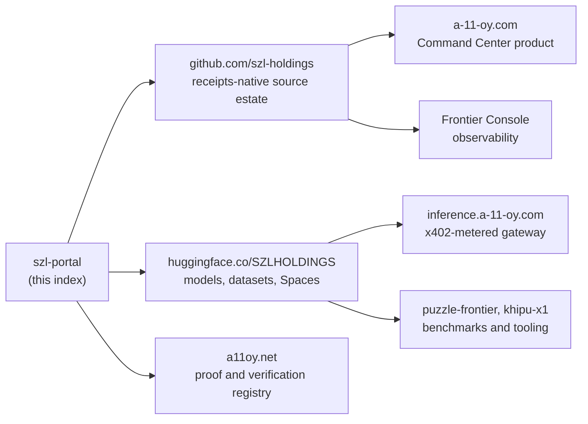

# szl-portal

The front door to the **SZL Holdings** governed-AI estate.

This repository is a **README-only link index**. It publishes no backend, no package and no deployment of its own. It exists so that an investor or developer arriving at `szl-portal` gets an honest, current map of the estate in one place, with nothing promised that is not in evidence.

## Audit state (MEASURED 2026-11-19T21:10Z)

| Component | State | Evidence |
|---|---|---|
| Link index (this README) | **PRESENT** | this file |
| FastAPI backend | **NOT_PRESENT_IN_REPO** — ROADMAP | repository tree contains README and LICENSE only |
| `szlholdings` Python SDK (PyPI) | **NOT_PUBLISHED** | `pypi.org/project/szlholdings` returned HTTP 404 on 2026-11-19 |
| Cloudflare Pages/Worker mirror | **NOT_PRESENT** — owner-gated ROADMAP | billing and DNS are owner-only per doctrine; not verified here |
| Monetization docs | **NOT_IN_THIS_REPO** | canonical monetization material is linked below |

> The earlier description of this repository promised a FastAPI backend, a PyPI SDK, a Cloudflare mirror and monetization docs. None of those existed in evidence, so the promise is **removed rather than kept unbacked**. Estate doctrine: honest UNKNOWN over fabricated green, applied to ourselves first.

## The estate map

## Investor path

- Estate doctrine: [szl-doctrine](https://github.com/szl-holdings/szl-doctrine)
- One-page honest flagship status: [a11oy README](https://github.com/szl-holdings/a11oy#honest-status)
- Frontier evidence, byte-exact mirrors: [frontier-54-runs](https://github.com/szl-holdings/frontier-54-runs), [frontier-55-runs](https://github.com/szl-holdings/frontier-55-runs)
- Monetization receipts: [puzzle-frontier investor docs](https://github.com/szl-holdings/puzzle-frontier/blob/main/docs/INVESTOR.md), [szl-billing](https://github.com/szl-holdings/szl-billing) (Worker + D1 credits ledger, test mode first)
- Live revenue-gated gateway: [inference.a-11-oy.com](https://inference.a-11-oy.com) (/health returned {"status":"ok"} on 2026-11-19)

## Developer path

- Build with source: [github.com/szl-holdings](https://github.com/szl-holdings)
- Hub inventory: [huggingface.co/SZLHOLDINGS](https://huggingface.co/SZLHOLDINGS)
- Published Python package: [khipu-x1 on PyPI](https://pypi.org/project/khipu-x1/) (0.1.2, verified 2026-11-19)
- Receipts spec for integrators: [governed-receipt-spec](https://github.com/szl-holdings/governed-receipt-spec)

## Use limits

- A link, a badge or a running surface is not a certification. Check dated evidence at the target before relying on any claim.
- This index is a convenience, not the source of truth. The system of record for each claim is the receipt or repository it links to.

## License

Apache-2.0, aligned with the estate. (c) SZL Holdings.

---

SZL Holdings · szl-portal · honest index, no unbacked promises · Apache-2.0

