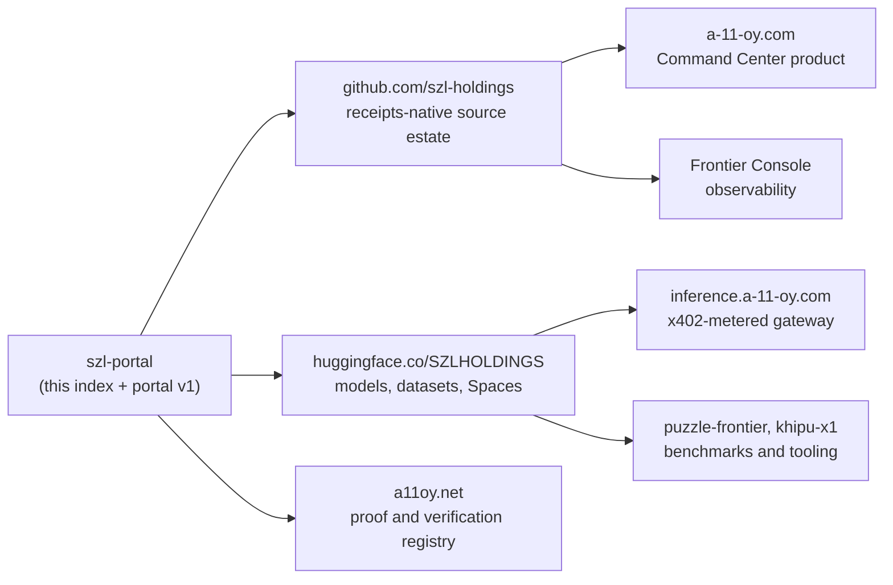

# szl-portal

The front door to the **SZL Holdings** governed-AI estate.

This repository is the single investor- and developer-facing surface for the
whole estate, aligned across GitHub (`szl-holdings`), Hugging Face
(`SZLHOLDINGS`), PyPI, and Cloudflare. Portal v1 (PR #2, 2026-11-19) adds the
deployable artifacts; every claim below stays dated and owner-gated where
required.

## What is in this repo (portal v1)

| Layer | Directory | What it is |
|---|---|---|
| Frontend | `frontend/` | investor/dev portal (static, Cloudflare Pages-ready) |
| Backend | `backend/` | FastAPI estate inventory API (source in repo; not deployed) |
| Python SDK | `src/szlholdings/` | `szlholdings` package source (PyPI publish owner-gated) |
| Edge API | `cloudflare/worker/` | Cloudflare Worker mirror kit (deploy owner-gated) |
| Alignment | `ALIGNMENT.md` + bundled snapshot | GitHub ↔ Hugging Face source map, provenance-labeled |
| Delivery kit | `INVESTOR.md` `DEVELOPER.md` `MONETIZATION.md` `cloudflare/RUNBOOK.md` | investor brief, dev quickstart, revenue model, deploy runbook |
| Integrity | `PORTAL_MANIFEST.sha256` | per-file sha256 manifest of this build |

## Audit state (MEASURED 2026-11-19)

| Component | State | Evidence |
|---|---|---|
| Link index (this README) | **PRESENT** | this file |
| FastAPI backend | **SOURCE_PRESENT_IN_REPO** (PR #2); not deployed — any public service is owner-gated | `backend/app.py` |
| `szlholdings` Python SDK (PyPI) | **SOURCE_PRESENT_IN_REPO**; **NOT_PUBLISHED** (`pypi.org/project/szlholdings` 404 on 2026-11-19); first publish needs owner pending-publisher registration + GitHub Release v0.1.0 | `src/szlholdings/` |
| Cloudflare Pages/Worker mirror | **KIT_PRESENT_IN_REPO**; NOT_DEPLOYED — billing and DNS are owner-only per doctrine | `cloudflare/` |
| Monetization docs | **PRESENT** in this repo | `MONETIZATION.md` |

> A same-day audit (PR #1, measured 21:10Z) correctly found none of these in
> the repo and removed the earlier unbacked promises. Portal v1 (PR #2, merged
> after that audit) adds the actual artifacts while keeping the same rule:
> nothing is claimed as deployed or published that is not, and every
> activation step remains owner-gated. Estate doctrine: honest UNKNOWN over
> fabricated green.

## The estate map

## Investor path

- Estate doctrine: [szl-doctrine](https://github.com/szl-holdings/szl-doctrine)
- One-page honest flagship status: [a11oy README](https://github.com/szl-holdings/a11oy#honest-status)
- Frontier evidence, byte-exact mirrors: [frontier-54-runs](https://github.com/szl-holdings/frontier-54-runs), [frontier-55-runs](https://github.com/szl-holdings/frontier-55-runs)
- Monetization model for this portal: [MONETIZATION.md](MONETIZATION.md); estate receipts: [puzzle-frontier investor docs](https://github.com/szl-holdings/puzzle-frontier/blob/main/docs/INVESTOR.md), [szl-billing](https://github.com/szl-holdings/szl-billing)
- Live revenue-gated gateway: [inference.a-11-oy.com](https://inference.a-11-oy.com) (/health returned {"status":"ok"} on 2026-11-19)

## Developer path

- Build with source: [github.com/szl-holdings](https://github.com/szl-holdings)
- Hub inventory: [huggingface.co/SZLHOLDINGS](https://huggingface.co/SZLHOLDINGS)
- This repo's SDK: `pip install -e .` then `pytest` (network-free smoke tests); PyPI publish path is tokenless Trusted Publishing (see `.github/workflows/publish-pypi.yml`)
- Receipts spec for integrators: [governed-receipt-spec](https://github.com/szl-holdings/governed-receipt-spec)

## Use limits

- A link, a badge or a running surface is not a certification. Check dated evidence at the target before relying on any claim.
- This index is a convenience, not the source of truth. The system of record for each claim is the receipt or repository it links to.
- Source present in this repo is not the same as deployed or published; the audit-state table above is the boundary.

## License

Apache-2.0, aligned with the estate. (c) SZL Holdings.

---

SZL Holdings · szl-portal · honest index + gated v1 artifacts · Apache-2.0

